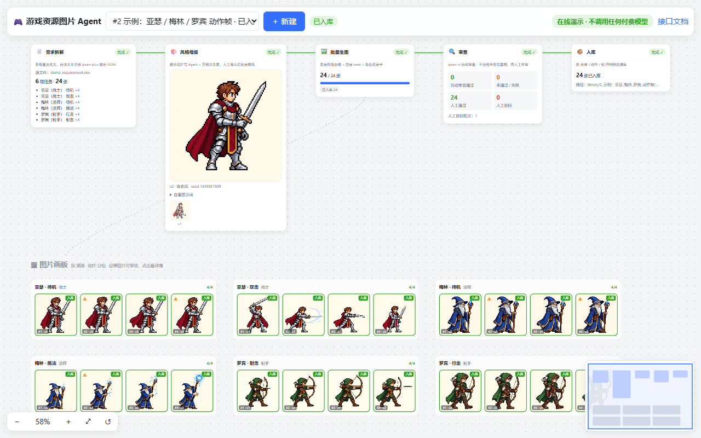
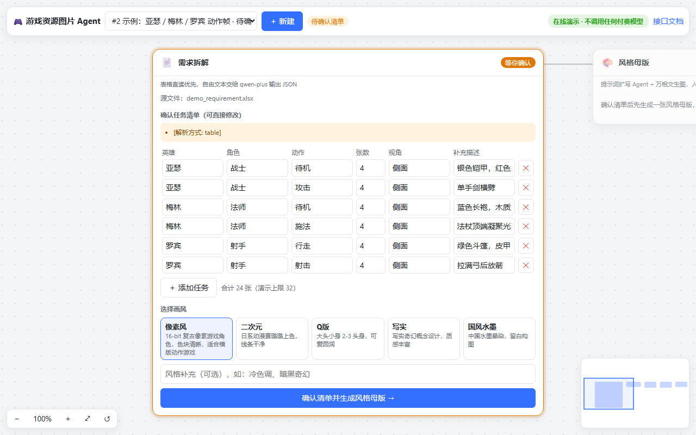
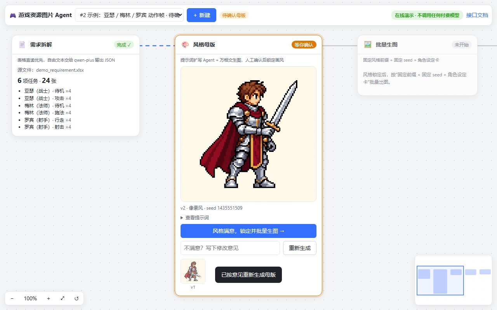
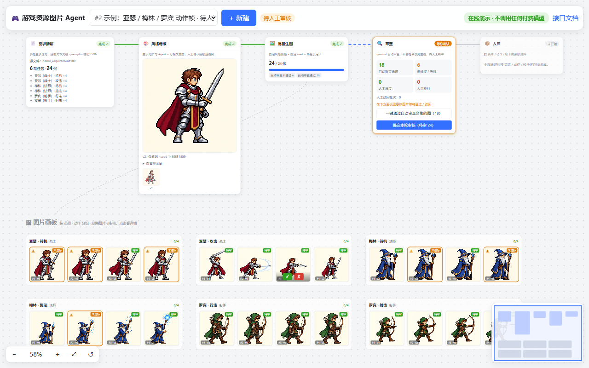
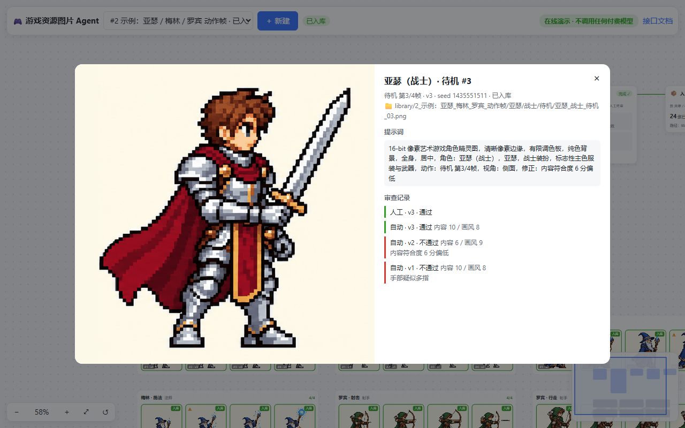

# 游戏资源图片 Agent 系统（game-asset-agent）

上传一份美术需求文档，系统用 4 个子 Agent 完成整条出图流水线：

**需求拆解 → 风格母版（提示词扩写）→ 批量生图 → 自动审查 + 人工审查 → 归档到项目资源库**



| 确认任务清单 + 选画风 | 风格母版（驳回后重新生成） |
|---|---|
|  |  |
| **画板里逐张人工审核** | **单张详情：提示词与审查记录** |
|  |  |

| 子 Agent | 位置 | 职责 |
|---|---|---|
| 需求拆解 Agent | `app/agents/requirement_agent.py` | 解析 docx / xlsx / pdf / csv / txt / md。表格优先按列名规则抽取，其余文本交给 qwen-plus（JSON 模式）。输出"英雄 / 角色 / 动作 / 张数"任务清单，合并重复项并标出问题 |
| 提示词扩写 Agent | `app/agents/prompt_agent.py`、`styles.py` | 内置像素 / 二次元 / Q 版 / 写实 / 水墨 5 种风格模板。生成角色设定卡，把动作展开成逐帧描述。提示词结构固定为"风格前缀 + 角色卡 + 帧描述 + 修正项"；审查不通过时根据问题生成修正项 |
| 生图 Agent | `app/agents/image_agent.py`、`app/ai/wanx_client.py` | 调用通义万相异步接口生成风格母版和批量资源图。单张图在内部完成"生成 → 自动审查 → 修正 → 重生成"闭环 |
| 审查 Agent | `app/agents/review_agent.py` | 先做规则检查（能否解码、尺寸、格式），再用 qwen-vl 对照母版给内容分和风格分并列出瑕疵。是否通过由代码按阈值判定，不交给模型自己决定 |

## 技术栈

- **API**：FastAPI + Pydantic v2，Swagger 文档在 `/docs`
- **Agent 编排**：LangGraph 1.x 的 StateGraph。人工确认节点用 `interrupt()` 挂起、`Command(resume=...)` 唤醒；PostgreSQL 环境下用 PostgresSaver 持久化 checkpoint，进程重启后流程可以续跑
- **大模型**：阿里云百炼 DashScope
  - qwen-plus：需求拆解
  - qwen-vl-max：图像审查
  - 通义万相 wan2.2-t2i-flash：生图
- **异步任务**：Celery + Redis，分两个队列：
  - `images`：生图，有限流、指数退避重试，`acks_late`
  - `workflow`：推进工作流
- **存储**：PostgreSQL（业务表 + checkpoint）；MinIO 对象存储，本地开发时可切换到本地磁盘
- **前端**：单页 Vue 3 无限画布（`app/static/index.html`），由 FastAPI 直接托管，不需要单独构建。五个 Agent 节点用贝塞尔连线串成流程，生成的图按"英雄 · 动作"分组成画板；平移、以光标为中心缩放、节点拖动、小地图、触屏双指缩放都是手写实现，不依赖画布库

## 流程与状态机

```
CREATED → PARSING → PLAN_CONFIRMING ─(人工确认清单 + 选风格)→ MASTER_GENERATING → MASTER_CONFIRMING
   MASTER_CONFIRMING ─(驳回 + 意见)→ MASTER_GENERATING（生成下一版母版）
   MASTER_CONFIRMING ─(确认)→ GENERATING ─(全部图片完成)→ HUMAN_REVIEWING
   HUMAN_REVIEWING ─(有驳回且未超轮次)→ GENERATING（只重生成被驳回的图，批注写进提示词）
   HUMAN_REVIEWING ─(全部通过)→ ARCHIVING → ARCHIVED
任一步骤异常 → FAILED（记录 error）
```

- **状态机**（`app/state_machine.py`）：合法迁移集中定义在 `TRANSITIONS` 中。`compare_and_set` 是一条带条件的 `UPDATE … WHERE status = 期望值`，保证并发时只有一方迁移成功。
- **生成屏障**：每个生图 worker 先提交自己那张图的终态，再统计本项目还有多少活跃资源。数到 0 的 worker 执行 `GENERATING → HUMAN_REVIEWING` 的 CAS，只有 CAS 成功的那一个去唤醒工作流，所以并发结束时也只会唤醒一次。
- **过期唤醒保护**：每次唤醒都带类型和令牌：
  - 确认母版时令牌是母版版本号；
  - 人工审核和生成完成时令牌是审核轮次。

  重复点击、Celery 重投、晚到的旧请求都会被工作流丢弃，不会把未审核的图误归档。
- **人工批注不丢失**：驳回批注累积写入 `Asset.human_fix`。之后无论自动审查再修正多少次，提示词里都会同时保留人工批注和自动修正项。
- **入库路径**：`library/{项目ID}_{项目名}/{英雄}/{角色}/{动作}/{英雄}_{角色}_{动作}_{序号}.png`，同时写一份 `manifest.json`，记录每张图的 prompt、负向提示词、seed、模型、风格和母版版本（审核记录在 `review_records` 表中）。

### 关于"风格一致"的说明

万相文生图接口**没有参考图参数**，不能直接"以母版为参考"出图。本项目用三项措施锁定风格：

1. 所有资源共用同一个风格前缀和负向提示词；
2. 默认沿用母版的 seed；
3. 同一个英雄的所有图片共用一张角色设定卡。

审查 Agent 会把母版图和待审图一起交给 qwen-vl，给出"风格一致性"评分作为兜底。

## 运行方式

### 方式一：Docker（完整版：PostgreSQL + Redis + MinIO + Celery）

```bash
cp .env.example .env          # 填入 DASHSCOPE_API_KEY；不填则自动进入 mock 模式
docker compose --profile app up -d --build
```

- 前端：http://localhost:8000
- 接口文档：http://localhost:8000/docs
- MinIO 控制台：http://localhost:9011

也可以只用 Docker 起基础设施，在本机跑 API 和 worker：

```bash
docker compose up -d postgres redis minio
pip install -r requirements.txt
uvicorn app.main:app --reload
```

```bash
celery -A app.tasks.celery_app worker -Q images,workflow -c 4 --loglevel=INFO
```

> Windows 上 Celery 不支持默认的 prefork 进程池，worker 要加 `--pool=threads`（或 `--pool=solo`）。

### 方式二：无 Docker 本地开发（SQLite + 线程池 + 本地磁盘）

在 `.env` 中启用 `.env.example` 底部的"本地开发配置"：

```
DATABASE_URL=sqlite:///./.data/app.db
TASK_MODE=thread
STORAGE_BACKEND=local
```

```bash
uvicorn app.main:app --reload
```

此模式不需要 Redis 和 Celery。注意流程状态保存在内存（InMemorySaver）里，重启后进行中的项目无法续跑。

### mock 模式

不填 `DASHSCOPE_API_KEY`（或设置 `AI_MOCK=true`）时，所有模型调用都换成本地模拟：

- 生图：示例需求（亚瑟 / 梅林 / 罗宾，像素风）使用预先画好的示例图（`app/static/examples/frames/`，由 `tools/slice_examples.py` 从序列帧原稿切出）；其他需求用 PIL 在 32×32 网格上现画像素小人再放大（`app/ai/pixel_sprites.py`），英雄名决定配色，职业决定武器，动作和帧序号决定姿势；
- 审查：按图片哈希打分，约 30% 不通过，用来覆盖重试分支；
- 需求拆解：用正则从文本里识别"英雄 角色 动作 N 张"。

不需要任何密钥就能跑通完整流程。

### 在线演示模式

设置 `DEMO_MODE=true` 后：

- **无条件走 mock**：即使环境变量或 `.env` 里有 `DASHSCOPE_API_KEY` 也会被清空，不会发出任何付费请求（`tests/test_demo_mode.py` 会拦截所有 HTTP 请求来验证这一点）；
- 收紧用量：单个任务最多 8 张，每个项目最多 32 张，上传文件最大 2MB；
- 前端顶部显示"在线演示 · 不调用任何付费模型"，并提供"使用示例需求"按钮（`app/static/examples/demo_requirement.xlsx`）。

Hugging Face Spaces 的部署文件在 `deploy/hf-space/`。

## 开源版说明

- 在线 Demo 和默认配置都是 mock 模式：示例需求展示的是预先画好的示例图，其他需求由本地程序现画，都不是实时调用模型的结果。要接真实模型，在本地 `.env` 里填自己的 `DASHSCOPE_API_KEY`。
- 原项目在客户环境里对 Qwen-VL 做过 LoRA 微调用于审查；微调数据和权重属于客户，开源版改为直接调用 qwen-vl-max 接口，审查逻辑（规则检查 + 双维度打分 + 代码按阈值判定）保持一致。

## 测试

```bash
pytest -q
```

测试使用 SQLite、同步任务模式和 mock 模式：

- 单元测试：状态机、CAS、表格抽取、文档解析、风格前缀、规则检查等；
- 端到端测试：上传 → 确认清单 → 驳回母版 → 批量生图 → 人工驳回回流 → 归档入库。覆盖过期唤醒丢弃、未审完不能提交、文件路径穿越拦截等场景。

## 主要接口

| 方法 | 路径 | 说明 |
|---|---|---|
| POST | `/api/projects` | 上传需求文档（multipart：name + file，≤ 20MB，演示模式 ≤ 2MB），启动流程 |
| GET | `/api/projects` / `/api/projects/{id}` | 项目列表 / 详情与各状态图片数量 |
| POST | `/api/projects/{id}/plan` | 确认（可修改）任务清单，选择风格 |
| GET / POST | `/api/projects/{id}/masters` / `/master` | 查看母版历史；确认或驳回（驳回必须填意见） |
| GET | `/api/projects/{id}/assets?status=` | 资源列表 |
| GET | `/api/assets/{id}` | 单张详情，含全部自动 / 人工审查记录 |
| POST | `/api/assets/{id}/review` | 人工审核单张（驳回必须填批注） |
| POST | `/api/projects/{id}/review/batch` | 批量审核 |
| POST | `/api/projects/{id}/review/submit` | 提交本轮审核：有驳回则回流重生成，全部通过则归档 |
| GET | `/api/projects/{id}/library` | 已入库资源 |

## 目录结构

```
app/
  agents/      4 个子 Agent + 风格模板
  ai/          DashScope 文本 / 视觉客户端、万相客户端、错误分类
  api/         FastAPI 路由
  parsers/     文档解析
  tasks/       Celery 应用、任务、派发抽象（celery / thread / sync）
  workflow/    LangGraph 工作流
  config.py  db.py  models.py  schemas.py  state_machine.py  storage.py  main.py
  static/      前端页面（无限画布）+ 示例需求
deploy/hf-space/  在线演示的 Dockerfile
tests/
```

## 已知限制

- 万相生成结果的 URL 只有 24 小时有效期，所以系统生成后会立即下载并转存到自己的存储。
- 万相的提示词上限是 500 字。超长时从末尾截断并打 warning 日志；风格前缀在最前面，不会被截掉，但末尾的修正项可能丢失。
- `create_all` 只建新表，不会修改已有表；表结构有变更时需要引入 Alembic，或者重建本地库。
